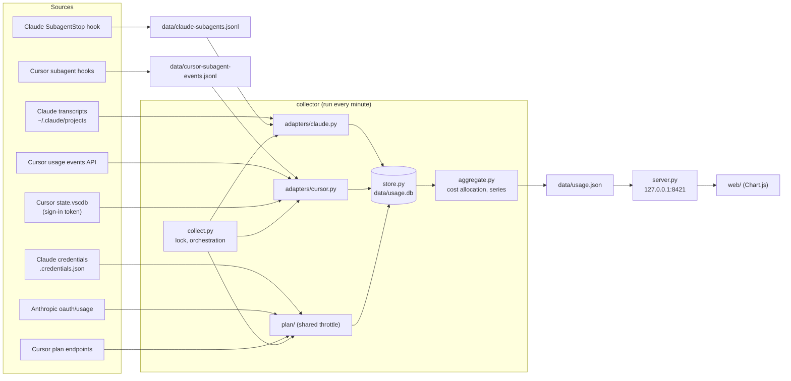
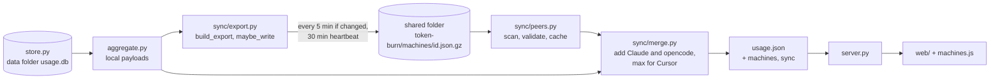

# Architecture

Final design of the combined Claude, Cursor, opencode and OpenAI token usage dashboard. The review that led to it is in `docs/ARCHITECTURE-REVIEW.md`. The exact module signatures, table definitions and JSON shape are in `docs/DATA-CONTRACT.md`, which is the authority; this page explains how the parts fit together and does not repeat it.

## Overview

- Python 3.9+ standard library only (including `sqlite3`), vanilla JavaScript, and Chart.js 4.4.1 vendored in `web/vendor/`. No build step, no pip packages.
- One collector runs every minute, writes a single `data/usage.json`, and a small loopback-only server serves it with the static page.
- Claude, Cursor, opencode and OpenAI are shown as columns from the left, each switchable on or off from the header and sharing the page width. All columns are produced by the same frontend code; only a small provider file (palette, labels, notes) differs.

## Components

| Component | File | Role |
|---|---|---|
| Entry point | `collector/collect.py` | Takes the lock, runs all three adapters and the plan lookups, prunes, builds and writes `usage.json`. One platform failing never blocks the others |
| Claude adapter | `collector/adapters/claude.py` | Reads transcripts incrementally, builds subagent runs from transcripts and the hook log |
| Cursor adapter | `collector/adapters/cursor.py` | Reads the sign-in token, fetches usage events incrementally, reads the hook log, builds subagent runs |
| opencode adapter | `collector/adapters/opencode.py` | Reads opencode's SQLite database read-only (v2 layout), builds usage rows and subagent runs from child sessions |
| Plan modules | `collector/plan/` | `claude_plan.py` (OAuth usage endpoint), `cursor_plan.py` (usage summary and fallbacks), `opencode_plan.py` (no plan quota), `__init__.py` (shared throttle) |
| Store | `collector/store.py` | SQLite in WAL mode: minute buckets, session totals, costs, subagent runs, plan samples, seen keys, key-value state |
| Aggregation | `collector/aggregate.py` | Cost allocation, sparse series, subagent runs, plan block |
| Effort | `collector/effort.py` | Normalises effort and splits Cursor model names |
| Utilities | `collector/util.py` | Constants, atomic write, file lock, rotating log, time helpers |
| Server | `server.py` | Loopback-only static and JSON server |
| Frontend | `web/` | One page, up to three columns |
| Hooks | `hooks/` | Claude and Cursor subagent recorders, both Python |
| CLI and schedulers | `token_burn/` | `token-burn` command (install wizard, uninstall, status, serve, collect, hook, sync, data) and per-OS scheduler back ends (Task Scheduler on Windows, launchd on macOS, systemd user units or cron on Linux) |

## Data flow, every minute

1. The per-OS scheduler (Task Scheduler, launchd or systemd user timer) runs `token-burn collect` every minute.
2. `collect.py` takes `data/collect.lock`. If another run holds it (and it is not stale, 300 s), this run exits quietly.
3. **Claude adapter.** It discovers `projects/*/*.jsonl` and `projects/*/*/subagents/agent-*.jsonl`, skips files older than 30 days, reads each from its saved byte offset to the last complete line, and turns each assistant line into one usage record. Duplicates are dropped through the `seen` table. `cost-state` lines update the per-session cost. Subagent runs are merged from the transcripts and `data/claude-subagents.jsonl`.
4. **Cursor adapter.** It reads the access token (read-only) from `state.vscdb`, then fetches usage events from `last_ts` minus 2 hours (or 30 days on backfill or first run), tries the cursor.com endpoint then the api2 fallback, pages through results, and stores each new event. Duplicates are dropped through the `seen` table. It reads `data/cursor-subagent-events.jsonl` and stores subagent runs.
5. **Plan lookups.** For each platform the shared throttle checks the last successful lookup. If under 590 s ago, no HTTP call is made. Otherwise the platform's fetch function runs, and on success a plan sample is stored.
6. **Prune.** Rows older than 30 days are removed.
7. **Aggregate.** `aggregate.py` reads the rows, allocates cost, and builds each platform's payload.
8. `usage.json` is written atomically and the lock is released.
9. The page, meanwhile, polls `/api/usage.json` every 60 seconds and redraws without a reload.

Opening or refreshing the dashboard spends no model tokens.

## Unified schema

Every record from either platform is a `UsageRecord` (see `collector/schema.py`):

| Field | Meaning |
|---|---|
| `platform` | `claude` or `cursor` |
| `agent_kind` | `primary` or `subagent` |
| `agent_id` | Empty for primary; the Claude agent id, or the Cursor subagent conversation id |
| `session_id` | Claude session id, or Cursor conversation id |
| `model` | Base model name without any effort suffix; "Auto Cost" for default, auto, synthetic or unknown |
| `effort_level` | `low`, `medium`, `high`, `extra`, `max`, or another lowercase word; empty if none |
| `input_tokens`, `output_tokens`, `cache_read_tokens`, `cache_write_tokens` | Kept separate, which neither source did |
| `cost_usd` | Direct cost. Cursor `chargedCents / 100`; Claude 0 until allocated |
| `timestamp` | Epoch seconds |
| `requests` | 1 per event |

`total_tokens` is input + output + cache read + cache write, as in both sources. Subagent runs use the separate `SubagentRun` dataclass.

### Platform mapping

| | Claude | Cursor |
|---|---|---|
| Primary | Lines with `isSidechain` false from main transcripts | Every usage event, unless matched to a subagent |
| Subagent | `isSidechain` lines and `subagents/agent-<id>.jsonl` | Events whose conversation id matches a subagent conversation in the hook log |
| Effort | `perTurnEffort` or `effort`, normalised | Parsed from the model name suffix |
| Model | Transcript label | Resolved name, with the effort suffix removed |

## SQLite tables

`data/usage.db` (WAL mode), defined in `collector/store.py` and listed in full in the data contract:

| Table | Holds |
|---|---|
| `usage_minute` | Sums per platform, minute, session, agent kind, agent id, model and effort: input, output, cache read, cache write, cost, requests |
| `session_tokens` | Lifetime token totals per session and model, used to share cost |
| `session_cost` | Latest Claude `costUSD` per session and model |
| `subagent_runs` | One row per subagent run, merged from hooks and transcripts |
| `plan_samples` | Plan percentages and reset times as JSON per sample time |
| `seen` | De-duplication keys with their minute, so pruning can remove them |
| `kv` | Offsets, `cursor:last_ts`, plan throttle state, metadata |

## API shape

`GET /api/usage.json` returns one document with a `claude`, a `cursor` and an `opencode` block, each holding `status`, `start`, `minutes`, `series`, `subagent_runs`, `plan` and `meta`. Per-minute arrays are sparse (only minutes with data). The full field list, the loopback rules and the routes are in `docs/DATA-CONTRACT.md`.

## Cost allocation

Done in `aggregate.allocate_costs`.

- **Cursor.** The row's own cost (`chargedCents / 100`). Nothing is estimated.
- **Claude.** Claude records cost per session and model, not per minute.
  1. If the session and model have a `cost-state` value, each row gets `cost * row_tokens / session_tokens`.
  2. If not (a session still running), the row is estimated at `sum(cost) / sum(tokens)` for that model across costed sessions, and flagged as estimated. The totals are in `meta.sessions_estimated` and `meta.estimated_cost_usd`.
  3. If there is no rate either, cost is 0 and the session is counted in `meta.sessions_without_cost`.
- **opencode.** The row's own cost, which is 0 for free or gateway models (`meta.cost_reported` is false if any row with tokens recorded no cost).
- **OpenAI.** A row's own cost if it has one, otherwise the tokens valued at OpenAI's published API list prices (`collector/openai_prices.py`). API cost only: a ChatGPT or Codex subscription is a flat fee, so this is a value comparison, not a bill. Update the price table when OpenAI changes its prices.
- **Claude subagent cost.** A subagent's cost is its share of the session cost by tokens, so it is the session cost share, not a separate figure from Claude. When only the hook totals exist (transcript gone), it is estimated at the model rate.

## Plan throttle

`collector/plan/maybe_lookup` is shared by both platforms.

- The state for each platform is kept in the `kv` table (`last_ok`, `last_attempt`, `status`).
- If the last successful lookup was under `PLAN_INTERVAL_S` (590 s) ago, no HTTP call is made and the stored state is returned.
- A failure does not move `last_ok`, so the next minute tries again.
- `last_lookup` and `next_lookup` are published so the page can show them.

This changes Cursor from every minute to about every 10 minutes (see `docs/CONFIGURATION.md`).

## Multi-computer sync

Sync lives entirely in the collector pass. The server and frontend only read `usage.json`; there is no new listener, and when sync is off the output is unchanged. The format and merge rules are in `docs/DATA-CONTRACT.md` and the user guide is `docs/SYNC.md`.

| Module | Role |
|---|---|
| `collector/sync/__init__.py` | Facade `apply(store, payloads, now, log, data_dir=None)`. Loads config, builds and writes this computer's export from deep-copied local payloads, scans peers, merges each platform and builds the machines list. Never raises: on error `sync.status` reads "sync failed (<ExcName>)" and payloads are unchanged |
| `collector/sync/config.py` | `config.json` load and save, machine ids, name cleaning, folder normalisation |
| `collector/sync/validate.py` | Capped gzip reading and strict validation of peer machine and control files |
| `collector/sync/export.py` | Builds the privacy-trimmed export, throttled atomic writes, conflict detection, adopted history |
| `collector/sync/peers.py` | Scans `machines/` and `control/`, last-good cache, retire and remove files |
| `collector/sync/merge.py` | Pure merge of local and peer data into platform payloads and the machines list |
| `collector/aggregate.py` | `build_usage_json(payloads, now, machines=None, sync=None)` adds the new keys only when given; `plan_block_from_samples` and `raw_plan_samples` support plan merging |
| `token_burn/installer.py` | Install wizard: install and data folders, sync mode, folder choice, joining, adoption, naming, upgrade, scheduler check |
| `token_burn/install_location.py` | Per-OS default folders, validation, copy and upgrade, Start Menu and Apps entries, `.desktop` file, `~/.local/bin` symlink, `location.json` pointer |
| `token_burn/folder_picker.py` | Native folder dialogs per OS (never `shell=True`), synced-root detection, `looks_synced` |
| `token_burn/sync_cli.py` | `token-burn sync ...` subcommands |
| `web/js/machines.js` | Client-side filtering of Claude and opencode by computer; the toggle row and Computers table are in `app.js` |

Data flow with sync on, each minute: the collector builds local payloads as usual, `sync.apply` exports this computer's data (when due), reads the other computers' files, adds Claude and opencode, takes the larger value for Cursor, merges plan samples, and `build_usage_json` writes the result with the `machines` and `sync` keys. Merged data is never re-exported, because the export is built from the local payloads before merging.

Install flow (zip builds): the wizard runs from wherever the zip was unzipped, copies the program folder to the chosen location (temp sibling, then rename), registers tasks and hooks pointing at the target folder, runs the collector task once to check the scheduler, then runs `sync now`. Scheduled tasks use `token-burnw.exe` and never prompt.

## Subagent attribution

- **Claude.** Subagent usage is known per line, so each run's input, output, cache and cost are recomputed from `usage_minute` rows with that agent id. The hook log supplies the agent type and a token fallback. Agent name is `<type> · <first 7 characters of id>`.
- **Cursor.** The hook gives type, model and status but no tokens. A usage event counts as subagent usage only if its `conversationId` matches a subagent conversation recorded by the hook (a hook record with a different `conversationId` and a `parentConversationId`, or the `subagentId` itself). If no event matches, the run shows `n/a` for tokens and cost and `meta.subagent_tokens_attributed` is false. Subagent usage then sits inside the primary figures.

## Frontend modules

| File | Role |
|---|---|
| `web/index.html` | Header (title, last updated, countdown, window selector, Tokens/Cost toggle, provider toggle buttons) and up to three columns |
| `web/js/format.js` | en-AU dates and numbers, token and US$ formatting |
| `web/js/stats.js` | Shared window and statistics maths: window anchoring, per-series sums, primary and subagent split, cumulative series, plan stats. Both platforms use it, so both calculate alike |
| `web/js/charts.js` | Chart.js setup for the usage chart and the plan chart, tick logic, theme colours, LTTB decimation |
| `web/js/tables.js` | Shared sortable table with search and model/effort filters (no pagination) |
| `web/js/providers/claude.js` | Warm palette, "Main session" label, Claude notes |
| `web/js/providers/cursor.js` | Cool palette, "Main agent" label, Cursor notes (including the subagent n/a note) |
| `web/js/providers/opencode.js` | opencode palette, labels and notes (zero-cost note, no plan data message) |
| `web/js/machines.js` | Per-computer filtering of Claude and opencode (sync only) |
| `web/js/burn.js`, `web/css/burn.css` | Decorative header animation: compositor-only CSS keyframes, JS only pauses it when the tab is hidden or reduced motion is set |
| `web/js/app.js` | Refresh loop, controls, the computer toggle row and Computers table, and the per-platform column |
| `web/css/app.css` | Layout and light and dark theme variables |

Each column, top to bottom: summary tiles, usage graph with model chips, plan usage (chart and table), Statistics table, Primary agent table, Subagents table. The columns stack below 1100 px.
